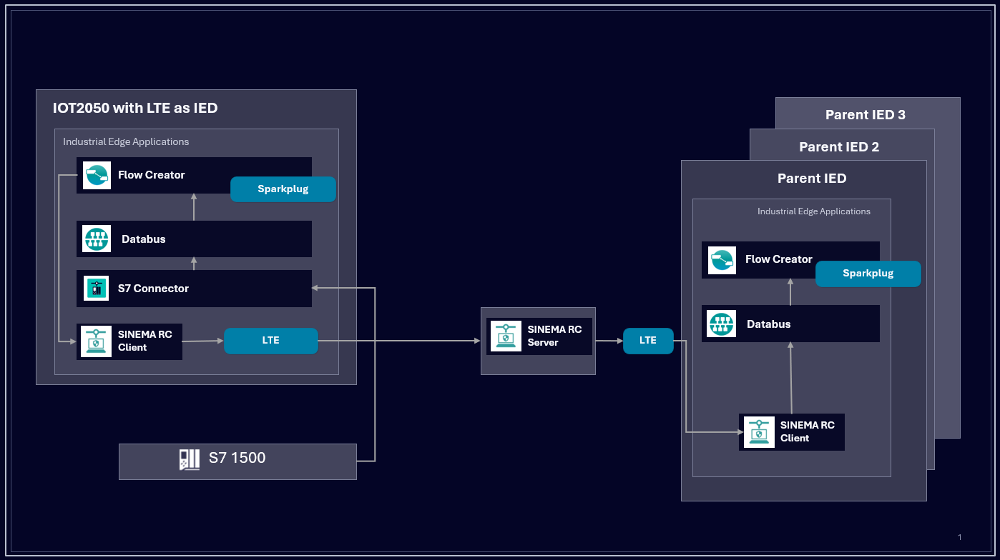

# Water / Wastewater over LTE – Test Repository

This repository contains test files and flows for validating a Water / Wastewater use case over LTE using Industrial Edge and Industrial Information Hub (IIH).

- [Water / Wastewater over LTE – Test Repository](#water--wastewater-over-lte--test-repository)
  - [Description](#description)
    - [Overview](#overview)
    - [General Task](#general-task)
  - [Repository Structure](#repository-structure)
  - [Requirements](#requirements)
    - [Prerequisites](#prerequisites)
    - [Used components](#used-components)
  - [Configuration Steps](#configuration-steps)
  - [Usage](#usage)
  - [Documentation](#documentation)
  - [Contribution](#contribution)
  - [License and Legal Information](#license-and-legal-information)

## Description

### Overview

This repository describes a setup for a **Water / Wastewater monitoring scenario over LTE**, where field devices communicate with a central system using Industrial Edge FlowCreator (MQTT) via LTE.

The focus is on validating data acquisition, data flow, and communication stability in distributed water or wastewater installations, such as pumping stations, reservoirs, or treatment facilities connected via LTE.

For Sinema RC capabilities please find information here: https://support.industry.siemens.com/cs/de/de/view/109996326

### General Task

The main goal of this use case is to validate **Water / Wastewater data transmission over LTE**, including:

- Collecting relevant process data from remote field devices
- Transferring data reliably via LTE
- Mapping incoming data to a standardized information model

The setup supports **parent / child device architectures**, where remote child devices communicate with a central parent device using Flow Creator connections.

## Repository Structure

The repository is structured as follows:

- [`test_files`](docs/test_results.md)  
  Contains all tests used for validating the Water / Wastewater over LTE use case.  

- [`flows`](src/)  
  Contains Flow Creator flows for:
  - Parent device configuration
  - Child device configuration
  - Data forwarding and aggregation between child and parent devices over LTE

These flows are intended to be imported directly into **Flow Creator** on the corresponding Industrial Edge devices.

## Requirements

### Prerequisites

- IOT2050 with installed LTE Module: https://docs.industrial-operations-x.siemens.cloud/r/en-us/v1.28/one-db-simatic-iot2050-industrial-edge-device/operation
- Access to an Industrial Edge Management System (IEM)
- Onboarded Industrial Edge Devices (IEDs) acting as:
  - Parent device
  - One or more child devices connected via LTE
- Stable LTE connectivity between child and parent devices
- Installed and operational Industrial Edge environment

### Used components

Industrial Edge:
- Industrial Edge Management
- Industrial Edge Devices (parent and child)
- Flow Creator

Communication:
- LTE router or integrated LTE connectivity
- Secure data transmission over LTE

## Configuration Steps

1. Onboard parent and child Industrial Edge Devices in IEM and install applications
2. Establish LTE connectivity for child devices
3. Import flows from the [`flows`](src/) folder into Flow Creator
4. Deploy child device flows on the corresponding remote devices
5. Deploy parent device flows for aggregation and forwarding

## Usage

Once the setup is deployed:

- Child devices transmit Water / Wastewater data over LTE
- Parent device aggregates and processes incoming data

Test cases and payloads located in the [`test_files`](docs/test_results.md) folder can be used to:
- Validate connectivity
- Check data integrity
- Perform functional and stability tests

## Documentation

You can find further documentation and help in the following links:

- [Industrial Edge Hub](https://iehub.eu1.edge.siemens.cloud/#/documentation)
- [Industrial Edge Forum](https://www.siemens.com/industrial-edge-forum)
- [Industrial Edge landing page](https://new.siemens.com/global/en/products/automation/topic-areas/industrial-edge/simatic-edge.html)
- [Industrial Edge GitHub page](https://github.com/industrial-edge)

## Contribution

Thank you for your interest in contributing. Anybody is free to report bugs, unclear documentation, and other problems regarding this repository in the Issues section. Additionally everybody is free to propose any changes to this repository using Pull Requests.

If you haven't previously signed the [Siemens Contributor License Agreement](https://cla-assistant.io/industrial-edge/), the system will automatically prompt you to do so when you submit your Pull Request. This can be conveniently done through the CLA Assistant's online platform. Once the CLA is signed, your Pull Request will automatically be cleared and made ready for merging if all other test stages succeed.

## License and Legal Information

Please read the [Legal information](LICENSE.md).

## Disclaimer

IMPORTANT - PLEASE READ CAREFULLY:

This documentation describes how you can download and set up a test environment which consists of or contains third-party software. 
By following this documentation you agree that using such third-party software is done at your own discretion and risk. 
No advice or information, whether oral or written, obtained by you from us or from this documentation shall create any warranty for 
the third-party software. Additionally, by following these descriptions or using the contents of this documentation, you agree that 
you are responsible for complying with all third party licenses applicable to such third-party software. All product names, logos, 
and brands are property of their respective owners. All third-party company, product and service names used in this documentation 
are for identification purposes only. Use of these names, logos, and brands does not imply endorsement.