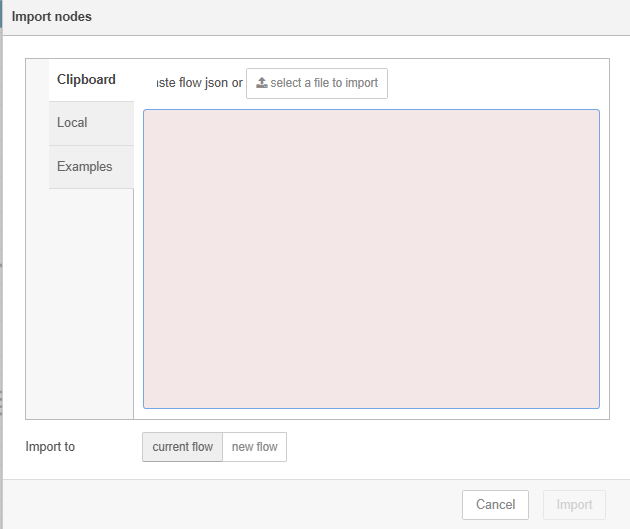
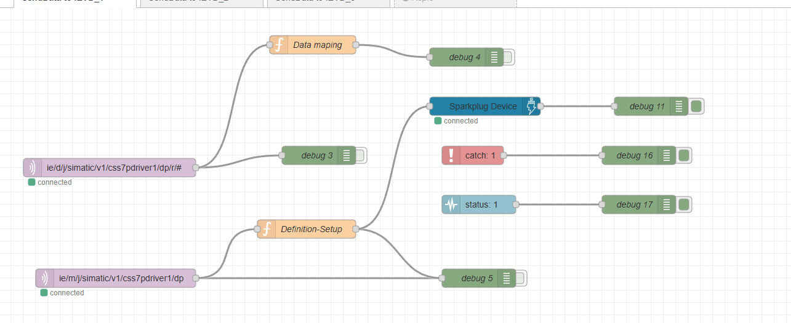
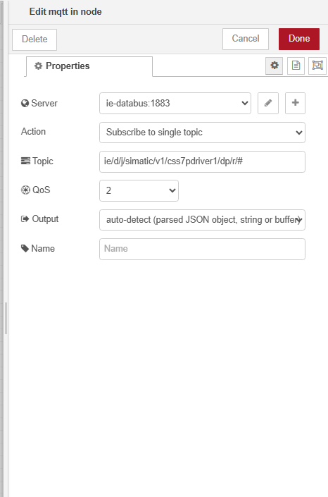
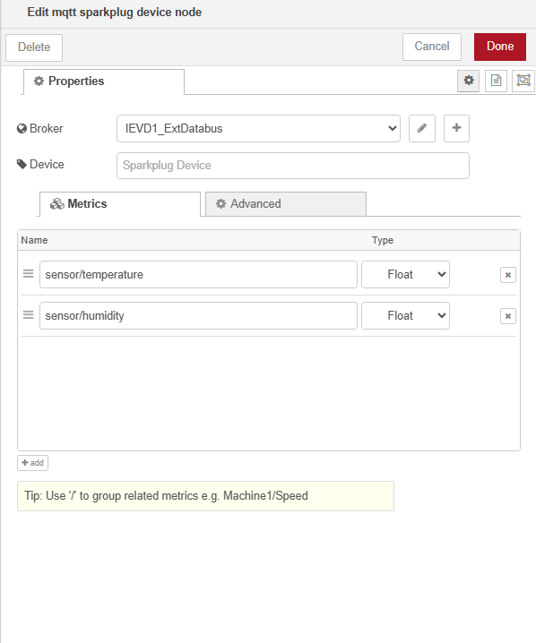
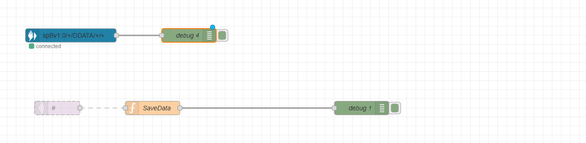

# Setup Child Device
The flows implement templates for the Connection to Databus and Parent Device. Those have to be configured to match the user setup.
For help in setting up the Databus, please use the following Link: https://docs.industrial-operations-x.siemens.cloud/r/en-us/v3.4.0/databus/working-with-databus-configurator

## Prerequisites - Child Device

On the Child Device please install the following applications:
- Connector (S7 Connector in this example)
- Common Configurator (IEM)
- Flow Creator
- Databus

Install all applications on the Child Device. 
Configure Databus on IEM (https://docs.industrial-operations-x.siemens.cloud/r/en-us/v4.0.0/databus/working-with-databus-configurator).

Configure the Connector to PLC via Common Configurator (https://docs.industrial-operations-x.siemens.cloud/r/en-us/v2.6/industrial-information-hub/get-data/configuring-connectors)

Enable publish to Databus in configuration process.

## 1) Import Flow in Industrial Edge Device
Download flow from this repository.

Import Flow into Flow Creator.

## 2) Configure Flow - MQTT Node
- Data is gathered from the Databus, therefore the credentials in Databus need to be changed to user setup

## 3) Configure Flow - Sparkplug B Node

Last, the sparkplugB Node has to be configured to send Data to the Databus of Child Device:
- Open Sparkplug B Node
- Configure MQTT Credentials

# Setup Parent Device
## Prerequisites - Parent Device

On the Parent Device please install the following applications:
- Flow Creator
- Databus (Databus prior to v4.0.0 needs additionally the External Databus App)
- IIH Essentials

Install all applications on the Child Device. 
Configure Databus on IEM (https://docs.industrial-operations-x.siemens.cloud/r/en-us/v4.0.0/databus/working-with-databus-configurator).

## 1) Import Flow in Industrial Edge Device
Download flow from this repository.

Import Flow into Flow Creator.

## 2) Configure Flow - MQTT Node
- Data is gathered from the Databus, therefore the credentials in Databus need to be changed to user setup

From there the user can process the data further in Flow Creator.