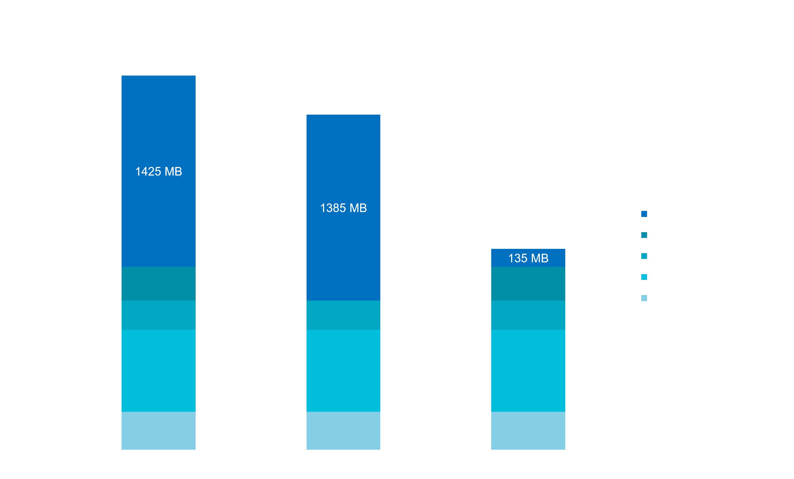
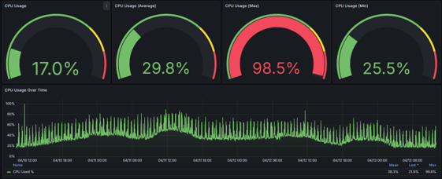

## Test Results
Connection between 2 IEDs using SparkplugB Nodes in FlowCreator:

| Datapoints/s | Acquisition Cycle (s) | Tags/s | Duration (min) | Latency | Payload Size (Raw KB) | Packets/s | Throughput (MiB) | Throughput (kbit/s) | Lost Messages |
|------------:|---------------------:|-------:|---------------:|:--------|----------------------:|----------:|-----------------:|-------------------:|--------------:|
| 200 | 1.0 | 1 | 10.13 | - | 6.299 | 5 | 3.85 | 52.98 | 0 |
| 400 | 0.5 | 2 | 8.50 | - | 6.299 | 9 | 6.36 | 104.65 | 0 |
| 500 | 1.0 | 1 | 11.32 | < 2 ms | 14.899 | 11 | 10.02 | 123.80 | 0 |
| 1000 | 1.0 | 1 | 10.72 | < 2 ms | 29.899 | 23 | 19.14 | 250.62 | 0 |
| 1000 | 0.5 | 2 | 5.37 | - | 15.899 | 24 | 10.19 | 265.38 | 0 |
| 2000 | 0.5 | 2 | 5.70 | - | 31.899 | 48 | 21.66 | 531.38 | 0 |
| 4000 | 0.25 | 4 | 2.07 | - | 31.899 | 92 | 17.74 | 997.19 | 0 |
| 5000 | 1.0 | 1 | 5.40 | < 2 ms | 153.899 | 115 | 49.59 | 1530.00 | 0 |

## Network Interface Comparison

| Datapoints/s | wwan0 (kbit/s) | tunSRC (kbit/s) | Difference (kbit/s) | Difference (%) |
|------------:|---------------:|----------------:|--------------------:|---------------:|
| 0 | 0.84 | 0.424 | 0.416 | 49.52% |
| 200 | 55.45 | 52.98 | 2.47 | 4.45% |
| 500 | 120.84 | 120.26 | 0.58 | 0.48% |
| 1000 | 250.00 | 240.86 | 9.14 | 3.66% |

## Key Findings

| Metric | Value |
|----------|--------|
| Maximum tested throughput | 5000 datapoints/s |
| Maximum measured bandwidth | 1530 kbit/s |
| Maximum packet rate | 115 packets/s |
| Message loss | 0% in all tests |
| Lowest measured latency | < 2 ms |
| Largest payload size | 153.899 KB |

## Performance Measurements
### Memory allocation
IOT 2050: 4GB total, 4GB useable

### Flow Creator
- Device Type: IOT2050sm​
- Measurement duration: 3 days​
- Data buffer time: None​
- 4000 tags/sec​

